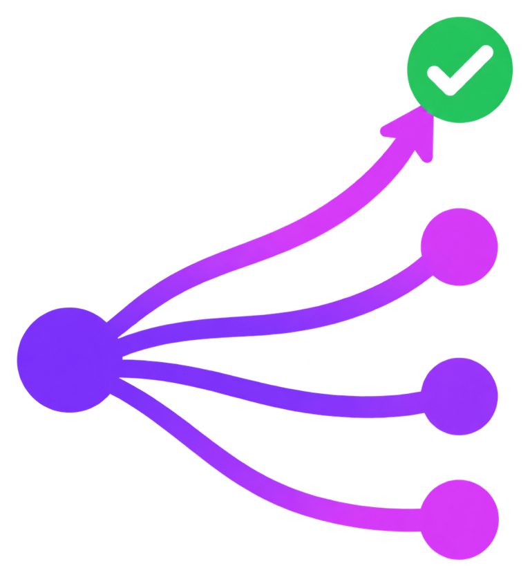
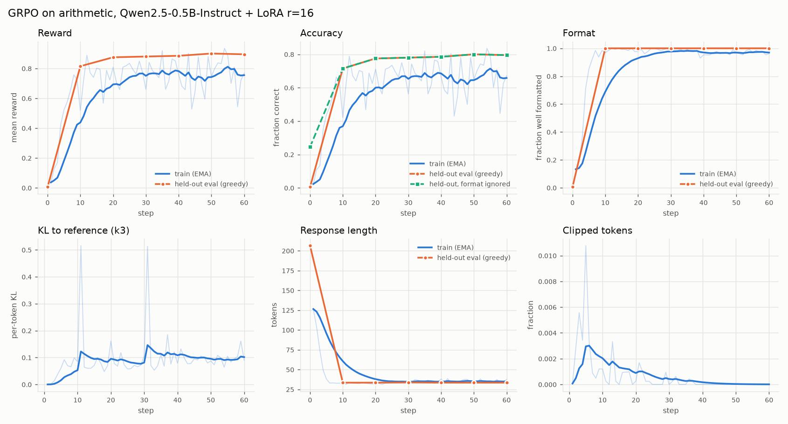
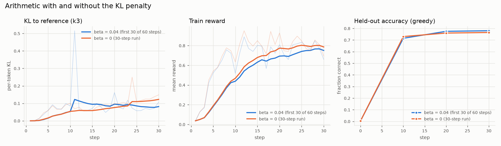
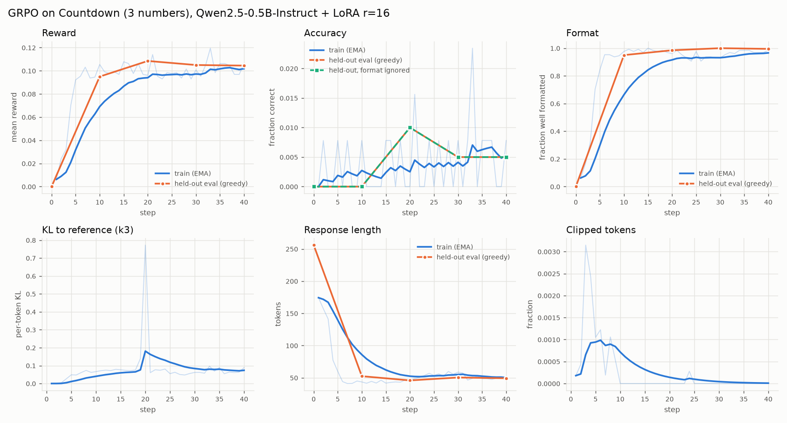

<p align="center">
  
</p>

# tiny-grpo

GRPO written from scratch in PyTorch, used to do reinforcement learning with verifiable
rewards on a small open model (Qwen2.5-0.5B-Instruct) on a laptop. The rewards are Python
functions that check the answer to an arithmetic problem or a Countdown puzzle. There is no
reward model, no value network and no RL library. The loss, the LoRA adapters, the rollout
bookkeeping and the tests are all in this repo.

On held-out arithmetic, 60 GRPO steps (52 minutes on an M4 Pro) took greedy accuracy from
0.5% to 79.5%. A lot of that jump is the model learning the answer format and learning to stop
rambling. Grading the base model generously, ignoring the format and giving it four times the
token budget, it gets 32%, so the real improvement is closer to 32% to 79.5%. On Countdown the
same setup learned the format and almost nothing else, which I also go through.

## Why I built this

I wanted to see what RL with verifiable rewards actually does to a small model. The R1-style
papers describe the effect at the level of benchmark tables, and that doesn't tell you much
about what changes in the completions step to step. I also wanted to understand two design
choices properly rather than just nod along:

- GRPO drops PPO's value network and uses the other samples for the same prompt as the
  baseline. How well does that work when most groups are all right or all wrong?
- The objective still carries PPO's ratio clipping and a KL penalty to a frozen reference.
  What do those two terms contribute in practice at this scale?

The best way I know to answer questions like that is to write the thing out, test each piece
against a slow obvious version, and then watch a real run.

## What I read

- DeepSeekMath (Shao et al., 2024), which introduced GRPO. The objective below follows its
  equation for the outcome-supervised case, including the k3 KL estimator.
- DeepSeek-R1 (2025) for the `<think>`/`<answer>` format and rule-based rewards.
- DAPO (Yu et al., 2025) for token-level loss aggregation and asymmetric "clip-higher".
- "Understanding R1-Zero-Like Training" (Liu et al., 2025), the Dr. GRPO paper, for the two
  biases in the original formula: per-sequence length normalisation and dividing by the
  group's reward std.
- John Schulman's note "Approximating KL divergence" for why k3 is unbiased and non-negative.
- TinyZero, for the Countdown task.

## What's in here

```
src/tiny_grpo/
  grpo.py       advantages, log-prob gathering, clipped surrogate, k3 KL, loss aggregation
  lora.py       LoRA layers, adapter on/off switch for the reference policy, save/load
  policy.py     model loading, chat prompts, sampling, per-token log-probs
  update.py     rollout batches, reference scoring, one optimiser step with accumulation
  train.py      the training loop, cosine LR, checkpointing, JSONL metrics
  evaluate.py   held-out greedy pass@1, mean reward, format rate, length
  rewards.py    strict format parser, arithmetic and Countdown rewards (pure functions)
  tasks.py      seeded problem generators and the held-out split
  config.py     TOML config with unknown-key checking
  plot.py       metrics JSONL to a PNG of curves
  cli.py        tiny-grpo train | eval | plot | compare
configs/        arith.toml, countdown.toml, arith_no_kl.toml (ablation)
tests/          pytest, CPU only, offline, a few seconds
results/        metrics, curves, eval completions and before/after examples for each run:
                arith/, arith_no_kl/, countdown/ and countdown_v1/ (the failed first attempt)
```

## The objective

For each prompt $q$ the policy samples a group of $G$ completions $o_1, \dots, o_G$, and each
gets a scalar reward $r_i$ from the checker. The advantage of completion $i$ is its reward
relative to the rest of its group:

$$
\hat A_i = \frac{r_i - \operatorname{mean}(r_1, \dots, r_G)}{\operatorname{std}(r_1, \dots, r_G) + \epsilon}
$$

That is the whole replacement for the value network. Every token of $o_i$ gets the same
$\hat A_i$. With the importance ratio against the policy that generated the samples,

$$
\rho_{i,t}(\theta) = \frac{\pi_\theta(o_{i,t} \mid q, o_{i,<t})}{\pi_{\theta_\text{old}}(o_{i,t} \mid q, o_{i,<t})}
$$

and the k3 estimate of the KL to the frozen reference policy, per token,

$$
\mathbb{D}_{i,t} = \frac{\pi_\text{ref}(o_{i,t} \mid \cdot)}{\pi_\theta(o_{i,t} \mid \cdot)} - \log \frac{\pi_\text{ref}(o_{i,t} \mid \cdot)}{\pi_\theta(o_{i,t} \mid \cdot)} - 1
$$

the per-token objective is PPO's clipped surrogate minus the KL penalty:

$$
\ell_{i,t} = \min\Big(\rho_{i,t} \hat A_i,\ \operatorname{clip}\big(\rho_{i,t}, 1 - \varepsilon, 1 + \varepsilon\big) \hat A_i\Big) - \beta\, \mathbb{D}_{i,t}
$$

The original GRPO paper averages this over each completion's tokens, then over the group:

$$
\mathcal{J}_\text{seq}(\theta) = \frac{1}{G} \sum_{i=1}^{G} \frac{1}{|o_i|} \sum_{t=1}^{|o_i|} \ell_{i,t}
$$

The code supports three reductions (`loss.aggregation` in the config), all in
`grpo.aggregate`:

| mode | normaliser | used by | effect |
| --- | --- | --- | --- |
| `sequence` | $\frac{1}{G}\sum_i \frac{1}{\lvert o_i \rvert}\sum_t$ | GRPO | each completion weighs the same, so a token in a long completion counts for less |
| `token` | $\frac{1}{\sum_i \lvert o_i \rvert}\sum_i\sum_t$ | DAPO | each token weighs the same |
| `constant` | $\frac{1}{G \cdot L_\text{max}}\sum_i\sum_t$ | Dr. GRPO | a fixed constant, so no dependence on sampled lengths at all |

The `sequence` mode has a known side effect. Each token's weight is $1/\lvert o_i \rvert$, so
a long wrong answer ($\hat A \lt 0$) is penalised less per token than a short wrong one, and a
short right answer is rewarded more per token than a long right one. Over many steps that
pushes towards short right answers and long wrong ones. `tests/test_grpo.py` checks each mode on a
hand example (two completions of length 1 and 3 give 2.5, 1.75 and 7/6) and checks the
per-token gradient weights directly.

Setting `scale_advantages = false` drops the std division, which is the other half of
Dr. GRPO. Dividing by the std up-weights groups where the rewards barely differ, i.e. prompts
that are nearly always right or nearly always wrong.

## Design decisions

**LoRA, written by hand.** Full fine-tuning a 0.5B model with Adam needs weights, gradients
and two moment buffers in memory, plus a separate frozen copy for the reference policy.
LoRA (rank 16 on all seven linear projections in every block, 8.8M trainable parameters out of
503M) cuts that to the adapter state. I wrote the LoRA layer myself instead of using `peft`
because it's about 60 lines and the one extra thing GRPO needs is a switch to turn the
adapters off. `B` starts at zero, so the policy equals the base model at step 0 and the KL is
exactly zero there. A test checks that.

**The reference model shares the base weights.** $\pi_\text{ref}$ is the base model, which is
the LoRA model with adapters disabled. `lora.adapters_disabled(model)` flips a flag on every
adapter for the duration of a `with` block. No second copy of the weights, and no chance of
the reference drifting.

**Token-level aggregation by default.** I went with DAPO's token mean. The length bias of the
per-sequence mean is the thing I'd least like to be confounding a small experiment where
response length is one of the things I'm watching. `constant` would work as well; it is the
same as `token` up to a scale that changes when the batch's total length changes.

**Gradient accumulation normalises by the whole mini-batch.** With token-level aggregation, a
naive loop that averages each micro-batch over its own tokens and then averages the
micro-batches gives tokens in short micro-batches more weight. `optimisation_step` passes the
mini-batch's total token count (or sequence count, or $G \cdot L_\text{max}$) into every
micro-batch's loss, and a test checks that the accumulated gradient matches a single
full-batch step for all three modes.

**$\pi_\text{old}$ is only computed when it can differ.** With one optimiser step per batch of
rollouts, $\pi_\theta = \pi_{\theta_\text{old}}$ at the time of the update, the ratio is
exactly 1 and clipping never fires, so the code skips that forward pass and uses the detached
current log-probs. My config does two optimiser steps per batch (`minibatches_per_epoch = 2`)
so the second one is off-policy and the clip is live.

**Sampling is pinned.** Qwen2.5-0.5B-Instruct ships a generation config with
`temperature=0.7, top_p=0.8, top_k=20, repetition_penalty=1.1`. If any of those apply during
rollouts, samples come from a different distribution than the one whose log-probs the loss
uses, and every importance ratio is off from the first step. `policy.sampling_config` sets all
of them explicitly, and a test gives a tiny model those same defaults and checks that the
scores the sampler drew from are the raw logits.

**Log-probs match the sampler.** Prompts are left padded so all completions start at the same
column, and position ids come from the attention mask the same way `generate` computes them.
Tests compare the batched log-probs against an unpadded, one-token-at-a-time loop, against the
logits `generate` actually sampled from, and against the same sequence with extra left
padding.

**The vocabulary projection is chunked.** Qwen2.5 has a 151,936-token vocabulary. Logits for
8 completions of 256 tokens are 311M floats, 1.2 GB in fp32 before log-softmax copies them,
and autograd holds on to them for the backward pass. `sequence_logprobs` runs the decoder
once, then projects 64 positions at a time under `torch.utils.checkpoint`, so the backward
pass recomputes each chunk's logits instead of storing them. Together with gradient
checkpointing on the decoder layers, that took the update from pushing the machine into swap
down to about 6-7 GB. One MPS detail is worth writing down. Projecting with `hidden @ weight.T`
against the tied 151,936 x 896 embedding matrix pushed MPS memory to 6.5 GB during a plain
scoring pass. `F.linear(hidden, weight)` computes the same thing and stayed under 4.5 GB.

**fp32, not bf16.** I started in bf16. On the very first update, where the policy, old policy
and reference are all the same weights, bf16 reported a per-token KL of 0.0008 and a mean
ratio of 1.0007.
That is pure numerical noise from scoring the same tokens in differently shaped batches, and
it is as large as the real signal in the first few steps. The same single Adam step also moved
the bf16 policy about a hundred times less than the fp32 one (KL 0.011 against 1.07 at lr
5e-5), which I read as small LoRA deltas being rounded away when added to bf16 activations.
In fp32 the first-update KL is 0 and the ratio is exactly 1. Rollouts got about 45% slower
(27 s to 40 s for 128 completions) and nothing else changed much.

**The format instruction goes in the user turn.** With the instruction in a system prompt the
base model produced the format in 2 of 128 samples at temperature 1. In the user turn it was
16 of 128. GRPO can only reinforce behaviour it samples, so that difference matters.

## The training run

Everything ran on an Apple M4 Pro with 24 GB of unified memory, on the MPS backend. There
were four runs, about 2 hours 35 minutes of machine time in total:

| run | steps | wall clock |
| --- | --- | --- |
| arithmetic | 60 | 52 min |
| Countdown, first attempt (stopped) | 12 | 23 min |
| Countdown, second attempt | 40 | 57 min |
| arithmetic without the KL penalty | 30 | 22 min |

plus a 7 minute eval of the base model with a longer token budget. The main arithmetic run:

| | |
| --- | --- |
| model | Qwen2.5-0.5B-Instruct, fp32, LoRA r=16, alpha=32 on q/k/v/o/gate/up/down |
| task | integer arithmetic: +/- of 3-4 digit numbers, 2-3 digit x 2 digit products |
| batch | 16 prompts x 8 completions = 128 rollouts per step |
| sampling | temperature 1.0, no top-p/top-k, up to 256 new tokens |
| loss | $\varepsilon = 0.2$, $\beta = 0.04$, token-level aggregation, std-scaled advantages |
| optimiser | AdamW, lr 2e-5, 10 warmup updates, cosine to 2e-6, grad clip 1.0 |
| updates | 1 epoch per batch, 2 mini-batches of 64, micro-batches of 8 |
| steps | 60 (120 optimiser updates, 7,680 rollouts) |
| eval | 200 held-out problems, greedy, every 10 steps |
| wall clock | 52 minutes including evals |

I picked the learning rate by taking one batch of rollouts and measuring the KL to the
reference after a few Adam steps on it. At 5e-5 a single fp32 step took the per-token KL to
1.07, which is a different model. At 2e-5 three steps kept it between 0.010 and 0.015.
LoRA on all seven projections in every layer is more sensitive than the usual SFT learning
rates suggest, probably because Adam's first steps move every adapter entry by about the
learning rate at once.

Reward is 1.0 for a correct answer plus 0.1 for a well-formed
`<think>...</think><answer>...</answer>` completion. A correct number in the wrong format gets
nothing.

### Arithmetic results



Held-out, greedy, 200 problems:

| | step 0 | step 60 |
| --- | --- | --- |
| accuracy (pass@1, strict format) | 0.5% | 79.5% |
| accuracy, format ignored | 24.5% | 79.5% |
| mean reward | 0.006 | 0.895 |
| well-formatted | 0.5% | 100% |
| truncated at 256 tokens | 46.5% | 0% |
| mean completion length | 206 tokens | 33 tokens |

By operation, format ignored:

| | step 0 | step 60 |
| --- | --- | --- |
| addition (75) | 17.3% | 93.3% |
| subtraction (81) | 40.7% | 90.1% |
| multiplication (44) | 6.8% | 36.4% |

The "format ignored" row takes the last integer in the completion, so it gives the base model
credit for a right answer written its own way. `results/arith/examples.md` has before and
after completions for the first few problems of each kind, including the wrong ones.

The 24.5% "format ignored" baseline is still unfair to the base model, because 46.5% of its
answers ran out of tokens mid-explanation. So I evaluated it again with a 1024-token budget
(`results/arith/eval_base_1024_tokens.jsonl`). Only 8.5% were truncated, and format-ignored
accuracy rose to 32%: addition 26.7%, subtraction 50.6%, multiplication 6.8%. That is the
honest "before" number for what the model can do in its own words, and 79.5% after training
is well clear of it. The base model's long explanations are often worse than no explanation
at all. It adds 361 and 607 column by column and concludes 86.

## What I learned

**Format comes first, and fast.** The training format rate went from 13% to 85% in five steps,
all inside the LR warmup, and greedy eval was 100% formatted by step 10. That's the cheapest
reward to collect and GRPO collects it first. If you only look at strict accuracy, 0.5% to
79.5% overstates what happened. Against the generous 1024-token baseline of 32% it's still a
large gain, but most of the change from step 0 to step 10 is format and length.

**Then it stopped thinking.** The base model writes long, often looping, explanations. Within
ten steps the policy had collapsed `<think>` to restating the equation, like
`<think> 361 + 607 = 968 </think> <answer> 968 </answer>`, and completion length fell from
about 126 tokens to 33. Nothing in the reward pays for reasoning, and on 3-4 digit addition the
model does the sum in one shot far better than it does by writing it out (93% against 27%). On
multiplication that is not true, and that's where it plateaued. The wrong products are near
misses (`64 * 77 = 4848`, true answer 4928), which is what you'd expect from a model guessing
digits without working. RL found the shortest behaviour that pays and sharpened it. It did not
find a multi-step method for the problems where a one-shot answer fails.

**The group baseline runs out of signal.** A group where all eight samples get the same
reward has zero advantage everywhere and contributes nothing. Over the first five steps 9% of
groups were like that. Over the last ten it was 60%, because most addition and subtraction
groups were all correct. So towards the end, well over half of every batch was spent
generating rollouts that couldn't move the weights, which is the flat part of the curves.
DAPO's dynamic sampling (throw those groups away and draw more prompts) is the fix I'd add
next.

**Clipping barely did anything.** With two optimiser steps per batch and lr 2e-5, the policy
moves very little between sampling and the second update. The mean clip fraction across the
run was 0.07% of tokens, peaking at 1.1% in step 5 during the format transition, and the mean
ratio stayed between 0.9989 and 1.0004. In this regime the clip is a guard rail that almost
never touches anything. It would matter with more epochs per batch or a higher learning rate.

**The KL settles, with spikes.** The k3 KL to the reference climbed to about 0.1 per token by
step 10 and stayed there. It spiked to 0.5 at steps 11 and 31, and to 0.16-0.19 a few other
times. k3 has a heavy tail when the policy puts near-certain mass on a token the reference
thought unlikely. My guess is that the format tokens are the culprits, since the policy now
emits them almost every time and the base model rarely did, but I didn't log per-token KL to
confirm it.

**Turning the KL penalty off changed the KL, not the result.** To see what $\beta$ buys, I
reran arithmetic with $\beta = 0$ (`configs/arith_no_kl.toml`) for 30 steps, still scoring the
reference so the KL gets logged. The ablation's LR schedule decays over 30 steps rather
than 60, so it takes smaller steps than the main run in its second half, which if anything
should keep it closer to the reference.



| | $\beta = 0.04$, steps 1-30 | $\beta = 0$, 30 steps |
| --- | --- | --- |
| mean k3 KL, steps 1-10 | 0.052 | 0.053 |
| mean k3 KL, steps 11-20 | 0.123 (0.079 without the step 11 spike) | 0.076 |
| mean k3 KL, steps 21-30 | 0.077 | 0.131 |
| held-out accuracy at step 30 | 78.0% | 76.5% |

Without the penalty the KL kept climbing through the last third of the run, while with it the
KL had levelled off around 0.08. Accuracy was the same within noise; 1.5 points on 200
problems is three problems. So at this scale and length the KL term is a leash that nothing
pulls hard against. The reward is easy to satisfy close to the base model, and a few dozen
steps at lr 2e-5 on a LoRA doesn't go far. I'd expect it to matter in longer runs, or where
the reward can be gamed by drifting away from fluent text. I didn't run either.

## Countdown: format yes, puzzles no

Countdown is the harder task. Given three numbers and a target, write an expression that hits
the target using each number at most once. The reward parses the answer with Python's `ast`
module, evaluates it with exact fractions, and allows only `+ - * /`, parentheses and the
given numbers. The config is the arithmetic one with `num_numbers = [3, 3]` and 40 steps.

This did not work, twice, and how it failed taught me more than the arithmetic run did.

**First attempt.** My format instruction originally ended with the example
`<answer> 42 </answer>`, for both tasks. In ten steps the Countdown policy had learned the
format and learned to copy that example's shape exactly. At the step 10 eval, 160 of 200
answers were just the target number, like `<answer>152</answer>`, which is well formatted
and always wrong. I stopped that run at step 12. It had produced 0 correct answers in 1,536
samples. Its logs are in `results/countdown_v1/`.

**Second attempt.** Each task now supplies its own example answer (`(7 - 3) * 5` for
Countdown), the question asks for an expression rather than an equation, and puzzles use
three numbers instead of three or four. The base model solved none of 128 sampled attempts
either way, so every bit of help mattered.



| held-out, greedy, 200 puzzles | step 0 | step 40 |
| --- | --- | --- |
| accuracy | 0% | 0.5% (1 puzzle) |
| well-formatted | 0% | 99.5% |
| truncated at 256 tokens | 100% | 0.5% |
| mean completion length | 256 tokens | 49 tokens |

Training solved 21 of 5,120 sampled puzzles over the run. Format reached 95% in six steps and
then there was almost nothing left to learn from: over the last ten steps, 75% of groups
had eight identical rewards. Here is what the final policy's 200 greedy answers look like:

| answer | count |
| --- | --- |
| uses a number that wasn't given | 95 |
| not a valid expression, almost always an equation with `=` in it (57) | 58 |
| only given numbers, wrong value | 33 |
| a bare number | 12 |
| badly formatted | 1 |
| correct | 1 |

The example leaked again, just differently. 61 of the 200 answers multiply by 5 when no 5 was
given, like `(18 + 21 - 4) * 5` for the numbers 18, 21, 4. The "think" block became a
restatement of the task (`use the numbers 18, 21, 4 and the operations +, -, *, / to get 25`)
with no search in it. A 0.5B model copies whatever concrete example is in front of it, and
with nearly every group scoring the same 0.1, there is no gradient pushing it off the copy.
The fixes I would try next, in order: a prompt with no concrete example answer; dropping
all-same-reward groups so the batch is spent on prompts that carry signal; and a larger model,
since 0.5B may simply be too small to learn search from this little signal. Partial credit for
"close to the target" is also an option, but it invites reward hacking and changes the task.

`results/countdown/examples.md` has before and after completions, including the one puzzle
the final policy solved.

## Running it

You need [uv](https://docs.astral.sh/uv/). The project pins Python 3.12. On Linux, torch comes
from the PyTorch CPU wheel index; on macOS the PyPI wheel already includes MPS.

```sh
uv sync

# Tests, lint and types: the same commands CI runs
uv run pytest
uv run ruff check
uv run ruff format --check
uv run mypy

# Train. Downloads Qwen2.5-0.5B-Instruct (about 1 GB) on first run.
uv run tiny-grpo train --config configs/arith.toml
uv run tiny-grpo train --config configs/countdown.toml

# Evaluate the base model, or a trained adapter, on the held-out set
uv run tiny-grpo eval --config configs/arith.toml
uv run tiny-grpo eval --config configs/arith.toml \
    --adapters runs/arith/checkpoints/last/adapters.pt --samples-out runs/arith/eval.jsonl

# Plot curves from a run, or overlay several
uv run tiny-grpo plot --metrics runs/arith/metrics.jsonl --out runs/arith/curves.png
uv run tiny-grpo compare --metrics runs/arith/metrics.jsonl runs/arith_no_kl/metrics.jsonl \
    --labels "beta 0.04" "beta 0" --out runs/kl.png
```

A run writes `metrics.jsonl` (one line per step, one per eval), `samples.jsonl` (a few
training completions per step), `eval_stepNNNN.jsonl` (every eval completion) and adapter
checkpoints to `train.output_dir`. `--resume` continues from the last checkpoint. The configs
are sized for a 24 GB Mac. On a smaller machine lower `optim.micro_batch_size` and
`rollout.generation_batch_size` first.

The test suite builds a 2-layer Qwen2 with a 48-token vocabulary in code, so it needs no
downloads and runs on CPU in a few seconds. It covers the advantage maths on hand-computed
examples, log-prob alignment against a naive loop, masking, the clip's gradient on both sides
of the range, the k3 estimator against exact KL on random categorical distributions, the
aggregation modes, exact gradient accumulation, and a single update on the tiny model moving
probability towards a positive-advantage completion and away from a negative one.

## License

MIT
